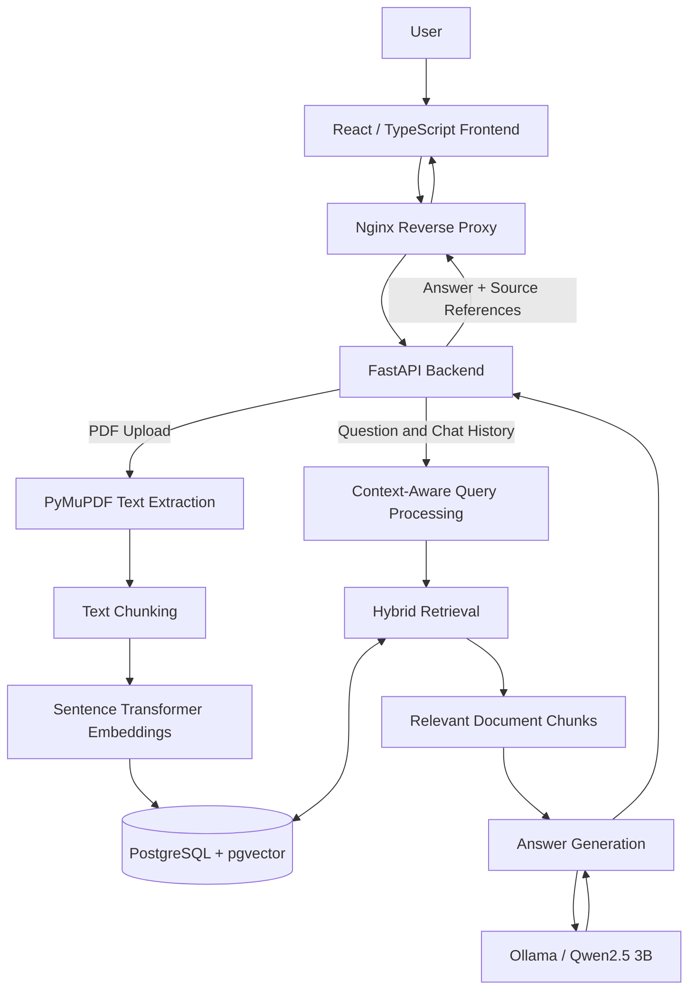

# Enterprise AI Assistant

**A full-stack, locally hosted document intelligence application powered by Retrieval-Augmented Generation (RAG).**

Enterprise AI Assistant enables users to upload PDF documents, retrieve relevant information through hybrid search, and ask natural-language questions with source-grounded answers.

The project was independently developed to explore applied AI engineering, RAG systems, local large language models, full-stack development, automated testing, and containerization.

> **Project status:** Functional local prototype with a Docker Compose setup. Designed for development and portfolio demonstration, not production deployment.

## Features

### Document Management
- Upload and process PDF files (up to 10 MB).
- Extract text and divide documents into searchable chunks.
- Generate vector embeddings for document chunks.
- Browse uploaded documents and their metadata.
- Delete documents and their stored chunks.

### Retrieval-Augmented Question Answering
- Semantic retrieval using Sentence Transformers.
- Hybrid retrieval combining semantic and lexical matching.
- Document-specific or knowledge-base-wide searches.
- Grounded answers generated by a locally hosted LLM.
- Source references with document names and page numbers.
- Handling of comparison questions and numbered procedures.
- Explicit fallback behavior when sufficient evidence is unavailable.

### Conversation Management
- Multi-turn conversations with context-aware follow-up questions.
- Multiple saved conversations.
- Create, rename, reopen, and delete chats.
- Conversation persistence using browser localStorage.
- Preservation of previous messages when a referenced document is deleted.

### User Interface
- React and TypeScript frontend.
- Responsive document and chat workspace.
- Muted-neutral design with light and dark modes.
- Persistent theme preference.
- Expandable retrieval evidence for generated answers.

### Engineering and Infrastructure
- REST API developed with FastAPI.
- PostgreSQL with pgvector for vector storage.
- Local LLM inference using Ollama and Qwen2.5.
- Docker Compose for the database, API, and frontend.
- Nginx for serving the production React build and proxying API requests.
- Automated backend tests with pytest.
- GitHub Actions continuous integration.

---

## Technology Stack

| Layer | Technologies |
|---|---|
| Frontend | React, TypeScript, Vite, CSS |
| Backend | Python, FastAPI, Uvicorn |
| Database | PostgreSQL 17, pgvector |
| Embeddings | Sentence Transformers, all-MiniLM-L6-v2 |
| Language Model | Qwen2.5 3B via Ollama |
| Document Processing | PyMuPDF |
| Retrieval | Hybrid semantic and lexical search |
| Containerization | Docker, Docker Compose, Nginx |
| Testing | pytest, FastAPI TestClient |
| CI | GitHub Actions |

---

## System Architecture



### How the RAG Pipeline Works

**1. Document ingestion**

Uploaded PDFs are processed using PyMuPDF. Extracted text is divided into overlapping chunks, and each chunk is converted into a vector embedding using `all-MiniLM-L6-v2`.

**2. Vector storage**

Document metadata, text chunks, and their embeddings are stored in PostgreSQL with pgvector.

**3. Query understanding**

The backend receives the user's question and recent conversation history. For context-dependent follow-up questions, it can resolve the question using previous turns.

**4. Hybrid retrieval**

Semantic similarity and lexical relevance are used to identify document excerpts related to the question.

**5. Answer generation**

Relevant excerpts are provided to Qwen2.5 through Ollama. The model is instructed to answer using supplied evidence and cite its sources.

**6. Source presentation**

The frontend displays the answer alongside expandable retrieved excerpts, including document names, page numbers, and similarity-related scores.

---

## Getting Started

### Prerequisites

Install the following:

- Docker Desktop with Docker Compose
- Ollama
- The `qwen2.5:3b` Ollama model

Ollama runs on the host machine in this configuration. The frontend, backend, and PostgreSQL database run in Docker containers.

### 1. Clone the Repository

```bash
git clone https://github.com/tingxi01/enterprise-ai-assistant.git
cd enterprise-ai-assistant
```

### 2. Install the Ollama Model

```bash
ollama pull qwen2.5:3b
```

Ensure the Ollama server is running:

```bash
ollama serve
```

If Ollama is already running through its desktop application or background service, do not start a duplicate server.

The backend container is configured to reach Ollama at:

```text
http://host.docker.internal:11434/api/chat
```

On Docker Desktop for macOS, `host.docker.internal` provides access to services running on the host. Ollama must be configured to accept connections from Docker if its default binding prevents access.

### 3. Start the Application

From the repository root:

```bash
docker compose up -d --build
```

The initial build may take several minutes because the Python dependencies include PyTorch and Sentence Transformers.

The embedding model may also need to be downloaded on first use.

### 4. Access the Application

| Service | URL |
|---|---|
| AI Assistant | http://localhost:5175 |
| FastAPI Health Check | http://localhost:8002/health |
| FastAPI API Documentation | http://localhost:8002/docs |
| PostgreSQL | localhost:5433 |

The application is bound to the local machine for development use.

### 5. Check Container Status

```bash
docker compose ps
```

The expected services are:

- `enterprise-ai-frontend`
- `enterprise-ai-backend`
- `enterprise-ai-postgres`

### 6. Use the Application

1. Open the AI Assistant at `http://localhost:5175`.
2. Upload a PDF document.
3. Select an uploaded document or search across the knowledge base.
4. Ask a natural-language question.
5. Inspect the answer and its retrieved sources.
6. Ask follow-up questions or create additional chats.

### 7. Stop the Application

```bash
docker compose down
```

This stops the containers while preserving the named database volume.

**Do not use `docker compose down -v` unless you intentionally want to delete the persistent data volumes.**

---

## Project Structure

```text
enterprise-ai-assistant/
├── backend/
│   ├── main.py
│   ├── answering.py
│   ├── comparison.py
│   ├── conversation.py
│   ├── db.py
│   ├── embeddings.py
│   ├── llm.py
│   ├── pdf_preprocessing.py
│   ├── repository.py
│   └── Dockerfile
├── frontend/
│   ├── src/
│   │   ├── App.tsx
│   │   ├── App.css
│   │   └── index.css
│   ├── Dockerfile
│   └── nginx.conf
├── scripts/
│   └── evaluate_rag.py
├── tests/
│   ├── test_answering.py
│   ├── test_api.py
│   ├── test_conversation.py
│   ├── test_chunking.py
│   └── rag_eval_cases.json
├── .github/
│   └── workflows/
│       └── tests.yml
├── .dockerignore
├── compose.yaml
├── requirements.txt
└── README.md
```

---

## Testing and Evaluation

The project includes automated tests for backend API behavior, conversation processing, and answer classification.

### Run Automated Tests

With Python dependencies installed in a local environment:

```bash
python -m pytest \
  tests/test_api.py \
  tests/test_conversation.py \
  tests/test_answering.py \
  -v
```

The automated test suite uses mocked external dependencies so that these tests do not require a running PostgreSQL database or Ollama server.

### GitHub Actions

The repository includes a GitHub Actions workflow that automatically runs backend tests when code is pushed to `main` or a pull request targets `main`.

### RAG Evaluation

A separate evaluation script exercises document-based questions:

```bash
python scripts/evaluate_rag.py
```

During local development, the evaluated test set achieved **18/18 passing cases** using the corresponding test documents and environment.

This is a result for a limited, project-specific evaluation set, not a claim of universal accuracy.

The evaluation requires its associated document fixtures to be available in the local environment. Private evaluation documents are not distributed with this repository.

---

## Design Decisions

### Local Language Model

Qwen2.5 3B is executed through Ollama, allowing inference to take place on the developer's machine without relying on a hosted LLM API.

### Hybrid Search

Semantic search helps retrieve conceptually relevant excerpts, while lexical matching complements it for specific words and phrases.

### Source-Grounded Answers

Answers are generated from retrieved document context, with source references exposed in the user interface.

### Conversation-Aware Queries

Recent conversation history supports follow-up questions whose meaning depends on earlier messages.

### Containerized Services

Docker Compose provides a reproducible development configuration for PostgreSQL, FastAPI, and the React frontend while keeping Ollama on the host.

---

## Current Limitations

This project is a development prototype and has several known limitations:

- Only PDF documents are supported.
- PDF uploads are limited to 10 MB.
- Scanned PDFs without extractable text may require OCR, which is not part of the current pipeline.
- Generated answers can still contain mistakes or omit details.
- Source similarity scores should not be interpreted as calibrated confidence probabilities.
- Conversations are stored in browser localStorage rather than a server-side user account.
- Ollama and the language model must be installed separately on the host.
- The current deployment is local and is not hardened for public multi-user access.

The system is intended as a technical demonstration, not a production-ready enterprise security solution.

---

## Potential Improvements

Future enhancements may include:

- User authentication and role-based document permissions.
- Server-side conversation storage.
- Support for additional document formats.
- Improved retrieval evaluation and observability.
- OCR support for scanned documents.
- Streaming model responses.
- Production security hardening and cloud deployment.

---

## About This Project

This project was independently developed as part of an AI engineering portfolio.

It demonstrates practical experience with:

- Designing and implementing RAG pipelines.
- Integrating embeddings, vector databases, and local LLMs.
- Building Python APIs and React interfaces.
- Managing conversational context and document retrieval.
- Writing automated tests and configuring CI workflows.
- Containerizing full-stack applications.

**Repository:** https://github.com/tingxi01/enterprise-ai-assistant
